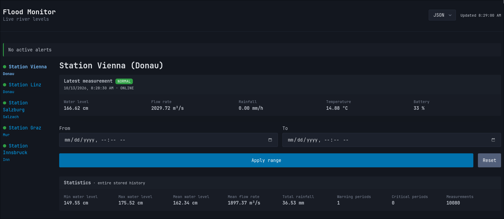

# Flood Monitor

Flood Monitor is a REST API for a simulated flood early warning system. Five measuring stations on the Donau,
Salzach, Mur and Inn create a new measurement every minute. The API provides the stations, their current and past
measurements, statistics and active alerts in JSON or XML. A web client shows the same data in the browser with
charts and filters.

The project is the solution for the task DEZSYS_GK71_FLOODMONITOR_REST. It uses Java 17, Spring Boot 3.2 and Gradle.
The web client uses jQuery, Chart.js and Pico.css.

## Getting Started

You need Java 17 or newer. The Gradle wrapper is part of the repository, so no other installation is necessary.

```bash
./gradlew bootRun
```

The application starts on port 8080. At startup it simulates the history of the last seven days, so the charts and
statistics have data immediately. This takes a few seconds. Until it is finished, the stations have no measurements
and show the warning level `UNKNOWN`. A different port can be given as an argument:

```bash
./gradlew bootRun --args='--server.port=8081'
```

After the start, the web client is available at [localhost:8080](http://localhost:8080) and Swagger UI at
[localhost:8080/swagger-ui.html](http://localhost:8080/swagger-ui.html).

The tests run with:

```bash
./gradlew test
```

They switch the simulation off with `simulation.enabled=false` and use a fixed clock, so the results don't depend on
random values or on the current time. The controller tests in `StationControllerTest` and `MeasurementControllerTest`
send real requests through MockMvc and check the status code, the format and the content of the response.
`WarningLevelServiceTest` checks the warning level calculation without Spring.

## Configuration

All settings are in `src/main/resources/application.properties`. The file contains no passwords or other secrets
and is also the configuration example. Every value can be changed at startup with `--args`, in the same way as the
port above.

The simulation creates a measurement for every active station every `simulation.interval` milliseconds. The default
is 60000, which is one minute. The rain model is only accurate with short ticks, so the interval should not be longer
than one minute. `simulation.enabled=false` switches the simulation off completely. The repository keeps the
measurements of the last `simulation.historyWindow`. At startup the simulation creates `simulation.prefillHistory` of
measurements, and before that it runs for `simulation.prefillWarmUp` so the rivers have a realistic level when the
history starts. These three values are durations such as `7d` or `12h`.

`simulation.hoursToDrain` and `simulation.hoursToCharge` set how many hours the battery needs to drain completely and
to charge completely. The other `simulation.*` values control the rain. `meanDryMs` is the average dry time between
two rain cells, `meanLifetimeMs` the average lifetime of a cell and `meanIntensity` its average rain intensity in mm/h.
`radiusKm` and `speedKmH` set the size and speed of a cell. A cell starts at the border of the area that `minLat`,
`maxLat`, `minLon` and `maxLon` define, and it disappears when it leaves that area or its lifetime ends.

`api.measurements.defaultLimit` is the number of measurements the history endpoint returns without a `limit`
parameter, and `api.measurements.maxLimit` is the highest value `limit` accepts. Both are higher than the number of
stored measurements, so a request without `limit` returns the full history.

## API

All endpoints are under `/api/v1`. The API returns JSON by default and XML if the request contains
`Accept: application/xml`. For all other formats it returns `406 Not Acceptable`.

- `GET /stations`: all stations, with the optional filters `river`, `isActive` and `warningLevel`
- `GET /stations/{id}`: one station with its current warning level
- `POST /stations`: creates a station from a JSON or XML body
- `GET /stations/{id}/measurements/latest`: the latest measurement of a station
- `GET /stations/{id}/measurements`: the measurement history, newest first, with the optional filters `from`, `to`,
  `limit` and `warningLevel`
- `GET /stations/{id}/statistics`: minimum, maximum and average water level, average flow rate, total rainfall and
  the number of measurements, warning periods and critical periods, for the range `from` to `to` or for the full history
- `GET /alerts`: all active stations at `WARNING`, `CRITICAL` or `UNKNOWN`, with the optional filters `river` and
  `warningLevel`

The server calculates the warning level of each measurement from its water level and the thresholds of the station.
A level below `warningWaterLevel` is `NORMAL`, a level from `warningWaterLevel` is `WARNING` and a level from
`criticalWaterLevel` is `CRITICAL`. The current warning level of a station is `UNKNOWN` if the station is inactive, has no
measurement or if its latest measurement is older than three simulation intervals. The thresholds are lower than real flood levels,
so warnings occur often in the simulation. The statistics count warning and critical periods instead of single
measurements. A period is a sequence of measurements in a row at that level or higher, so one flood counts once,
independent of how long it lasts.

A failed request returns an error in the requested format, with the status code, the reason and the path:

```json
{
  "timestamp": "2026-05-01T10:20:00Z",
  "status": 404,
  "error": "Not Found",
  "message": "No station with id: ST-999",
  "path": "/api/v1/stations/ST-999"
}
```

Unknown stations return `404`. Invalid parameters, such as `from` after `to`, a wrong date format, an unknown
warning level or a `limit` out of range, return `400`. A `POST` with an existing id returns `409`, and a body in an
unsupported format returns `415`. Unexpected errors return `500` without a stack trace.

Swagger UI documents every endpoint with its parameters, bodies and status codes, and
[docs/openapi.yaml](docs/openapi.yaml) is an exported copy of the specification.
[docs/api-requests.md](docs/api-requests.md) contains a curl command for every endpoint and every error case.
`scripts/success-cases.sh` and `scripts/error-cases.sh` run the same requests in JSON and XML.

## Web Client

The web client is in `src/main/resources/static` and the application serves it on the root URL. The sidebar lists
all stations with a colored dot for the current warning level: green for `NORMAL`, orange for `WARNING`, red for
`CRITICAL` and gray for `UNKNOWN`. A banner above it shows all active alerts.

When a station is selected, the page shows its latest measurement, the statistics, a chart and the measurement
history as a table. The chart has tabs for water level, flow rate, rainfall, battery and temperature, and the water
level chart also shows the warning and critical thresholds. A time range applies to the statistics, the chart and the
table together. The table also has a filter for the warning level and a limit for the number of rows.

The format switch in the header changes all requests between JSON and XML. For XML responses the client reads the
XML itself and shows the same data as for JSON. The page updates all data every 30 seconds, shows a loading
indicator while a request runs and shows the error message from the API if a request fails.



## Documentation

- [Architecture and data model](docs/architecture.md)
- [API requests](docs/api-requests.md)
- [OpenAPI specification](docs/openapi.yaml)
