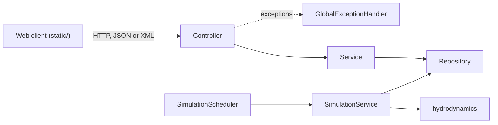
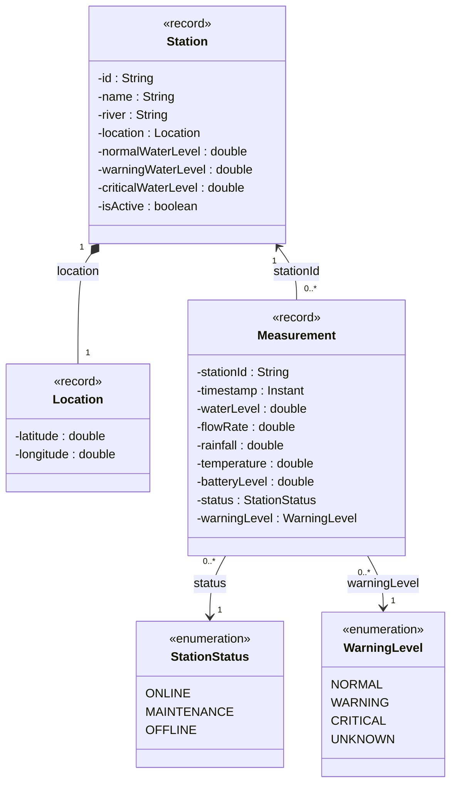

# Architecture

The application is one Spring Boot process. It simulates the stations, stores the measurements and provides
the REST API and the web client. All data is kept in memory, so a restart deletes it.

## Overview

A request goes from the controller to a service and from the service to a repository.
The simulation does not use the API. It writes the measurements directly into the repository.

## Packages

| Package | Content |
|---|---|
| `model` | `Station`, `Location`, `Measurement` and the enums `WarningLevel` and `StationStatus` |
| `repository` | `StationRepository` and `MeasurementRepository`, in-memory storage |
| `service` | Business logic: stations, measurements, statistics, alerts, warning levels and the simulation |
| `hydrodynamics` | Rain and water level models used by the simulation |
| `controller` | `StationController`, `MeasurementController`, `AlertController` |
| `dto` | Response classes the API returns, and `ApiError` |
| `exception` | Custom exceptions and `GlobalExceptionHandler` |
| `config` | Beans (`Clock`, `Random`, XML converter), OpenAPI info and `StationSeeder` |
| `resources/static` | Web client: `index.html`, `css/style.css`, `js/app.js` |

## Data Model

All model classes are Java records. Records create a public accessor for every field, so the diagram doesn't show them.
A measurement refers to its station by `stationId`.

Units:

- **Water levels:** cm
- **flowRate:** m³/s
- **rainfall:** mm/h
- **temperature:** °C
- **batteryLevel:** %
- **timestamp:** `Instant`, ISO-8601 in UTC, truncated to seconds

## DTOs

Except for `POST /stations`, which takes and returns a `Station`, the API doesn't return the model classes directly.
The DTOs add or change some values:

- **StationResponse:** the station plus `currentWarningLevel`, calculated from the latest measurement.
- **MeasurementResponse:** the measurement with all values rounded to two decimals.
- **AlertResponse:** station data together with the latest water level and warning level.
- **StatisticsResponse:** the statistics of a station for a time range.
- **List responses:** a list of a Response together with `totalCount`. The wrapper is necessary for XML, which needs one root element.
- **ApiError:** the error format for all failed requests.

## Storage

- **StationRepository:** a map from id to station, sorted by id.
- **MeasurementRepository:** one set per station, sorted newest first. It keeps only the last
  `simulation.historyWindow` (7 days, which is 10,080 measurements at a 60 s interval). Older measurements are removed.

Both use concurrent collections, because the simulation writes on its own thread while requests read.

## Startup

1. `StationSeeder` creates five stations on four rivers.
2. `SimulationScheduler` runs the prefill. It simulates for `simulation.prefillWarmUp` and
   for `simulation.prefillHistory` up to the current time. The warm-up lets the rivers settle,
   and the repository removes it again because it is older than the history window.
3. After the prefill a new measurement is created every `simulation.interval`.

The scheduler is not created during tests (`simulation.enabled=false`)

## Error Handling

The services throw custom exceptions, for example `StationNotFoundException` or `InvalidRequestException`.
`GlobalExceptionHandler` converts them and the Spring errors (wrong parameter type, unsupported format,
malformed body) into an `ApiError` with the matching status code. Unexpected errors return 500 without a stack trace.
